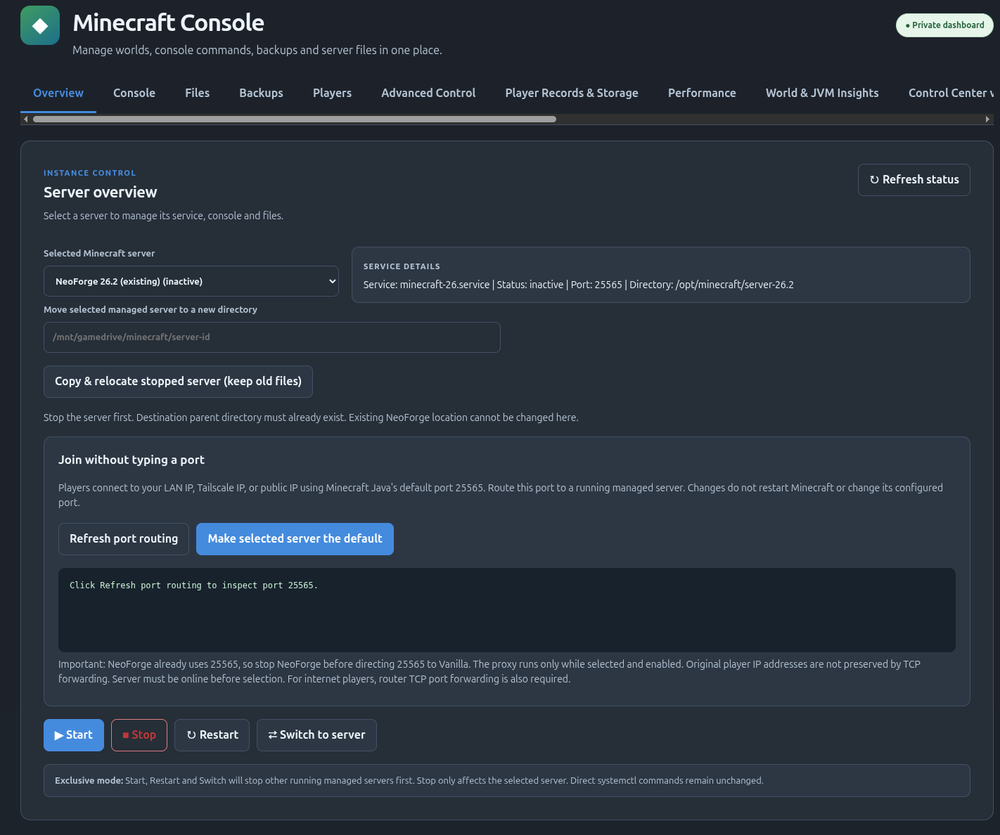
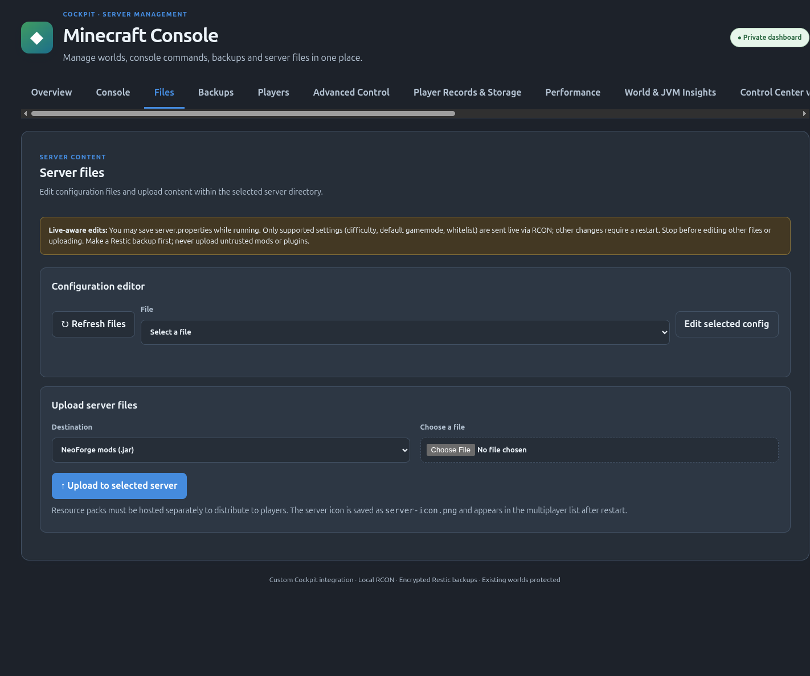
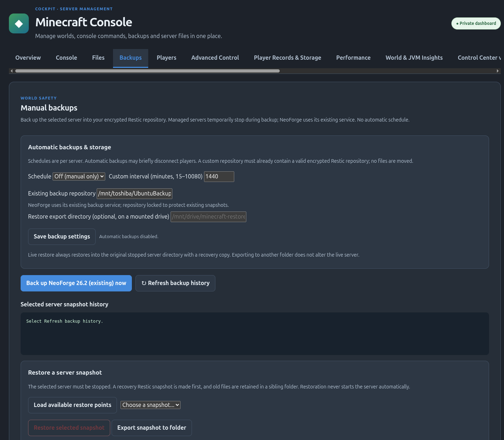
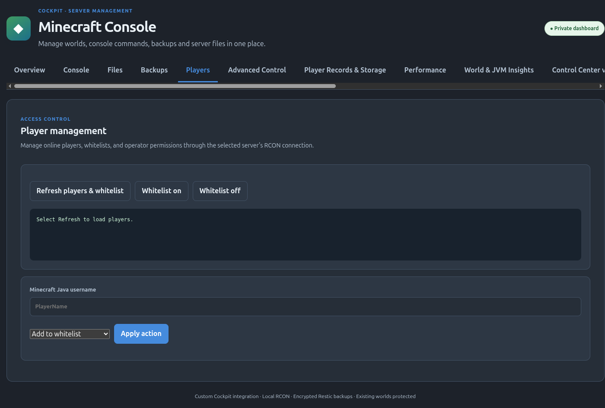
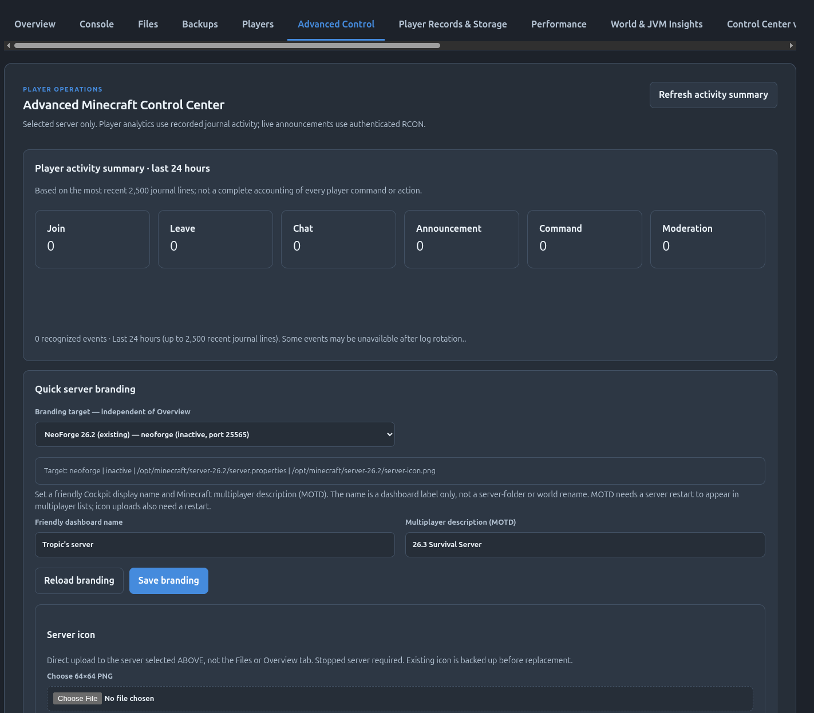
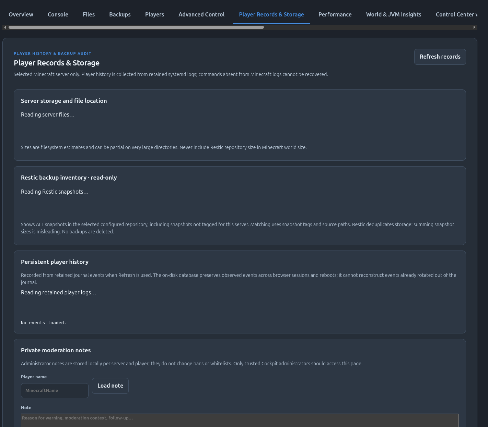
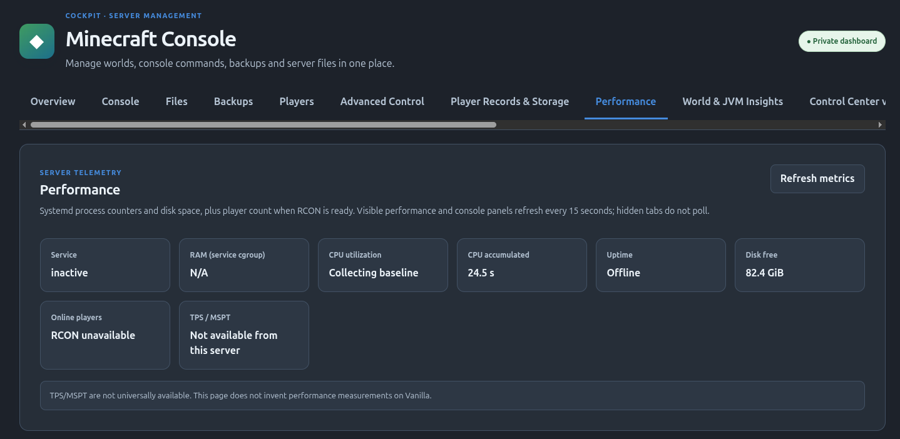
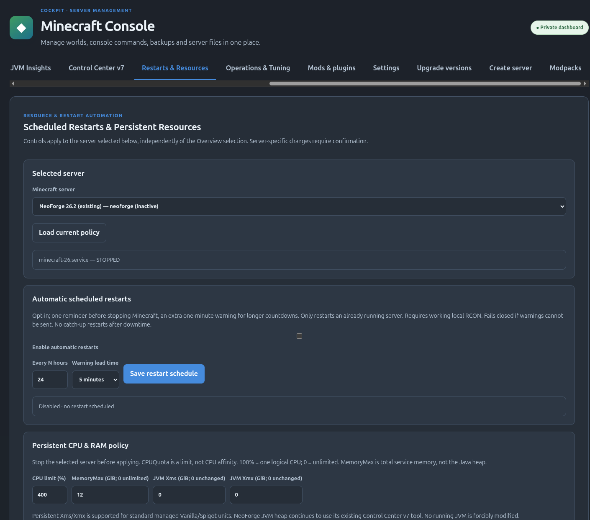
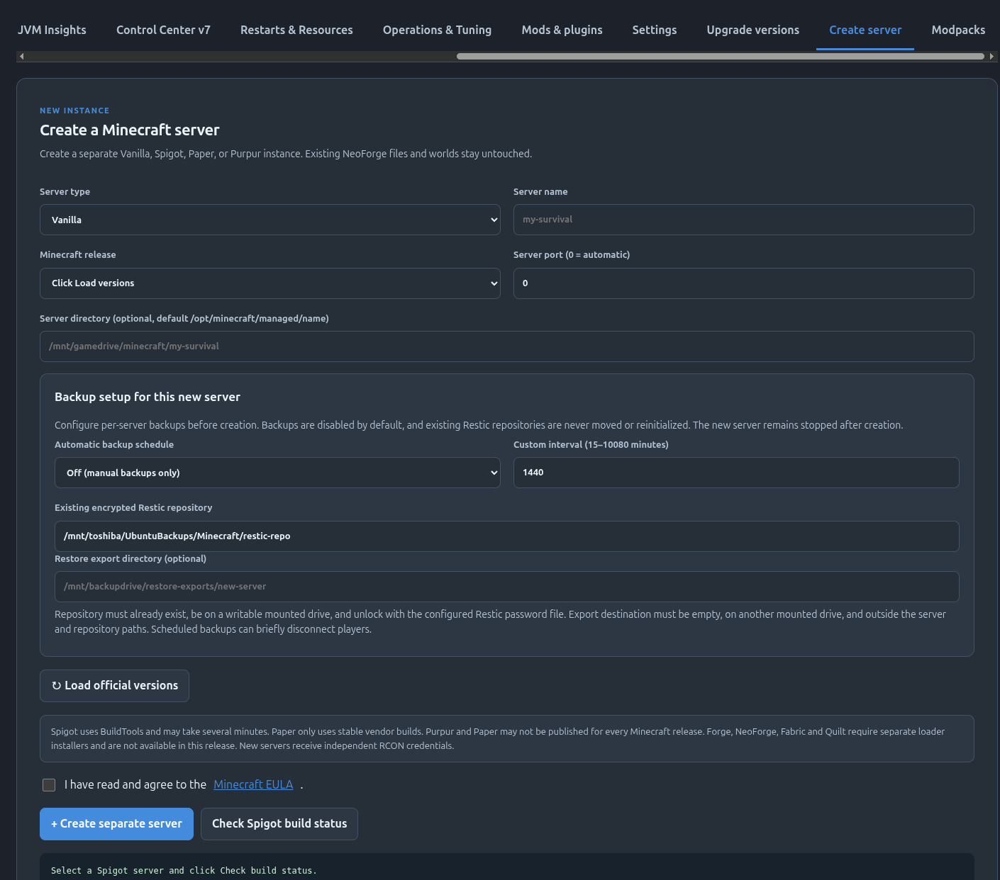
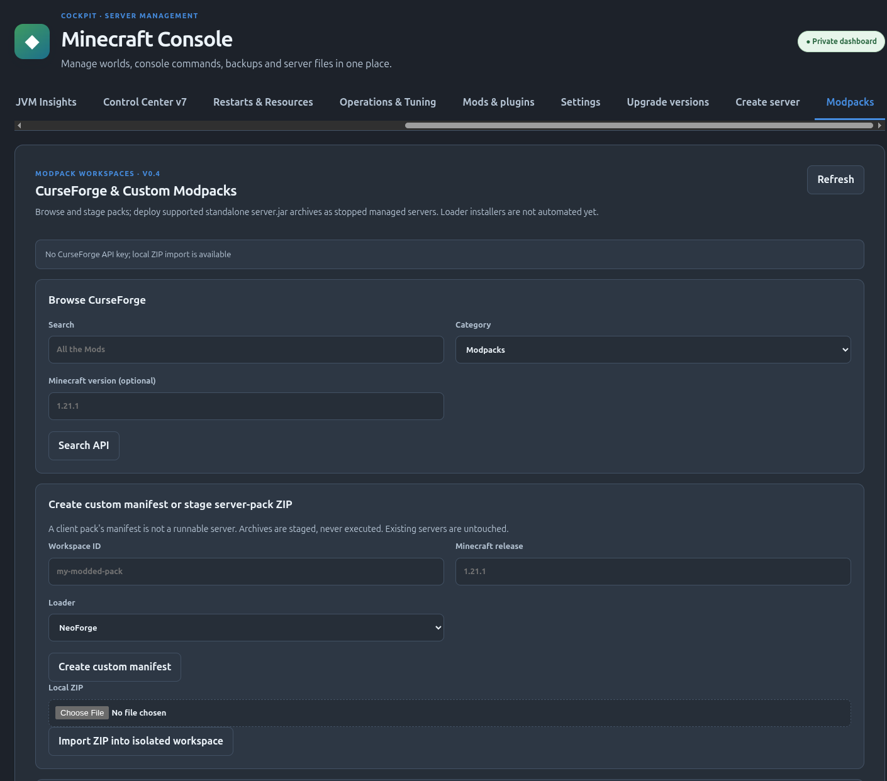

# Cockpit Minecraft Manager — Screenshots

Screenshots of the Minecraft Console management interface from an existing Ubuntu Cockpit installation.

**Privacy:** Before publishing these images in a public repository, review all screenshot contents carefully. Several show server labels, filesystem paths, mount locations, server versions, and backup configuration. Screenshots are for documentation only and should not be interpreted as instructions or as a guarantee that all features work on a fresh installation.

| View | Screenshot |
| --- | --- |
| Overview |  |
| File |  |
| Backup |  |
| Players |  |
| AdvancedControlCenter |  |
| PlayerRecords & Storage |  |
| Performance |  |
| Restarts & Resources |  |
| CreateServer |  |
| ModPack |  |
